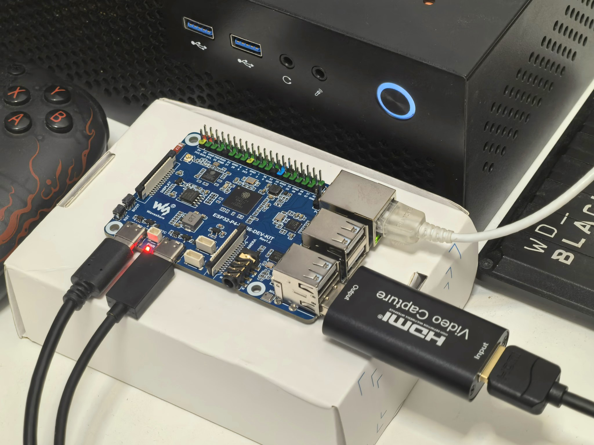
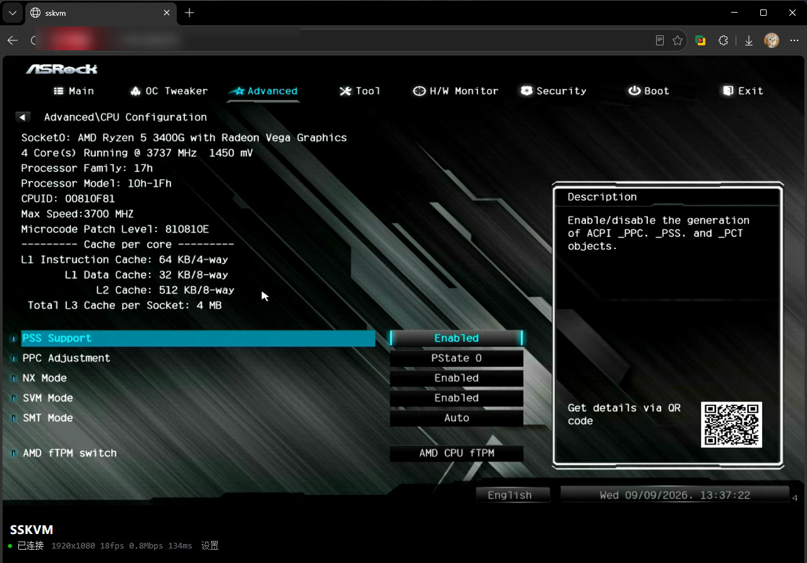

# sskvm

基于ESP32-P4开发板 + MS2109 HDMI采集卡制作的简易 IP-KVM

* 支持 480p60fps / 720p35fps / `1080P15fps`，适合BIOS控制、终端命令等低刷新运维场景
* 支持前端网页访问控制界面，键盘鼠标映射，实时显示画面连接信息
* 支持 Agent 通过HTTP请求 高清截图 / 绝对坐标触摸板点击 / 字符串输入
* RJ45有线网络连接，支持修改主机名，并使用 mDNS 广播
* 正在开发：网络镜像挂载、网络唤醒、无线插座控制、自制PCB版本

开发环境：ESP-IDF v6.0.3 官方容器，建议使用 Agent 协助项目部署和开发

硬件总成本约 `￥133`：[ESP32-P4开发板 ￥118](https://detail.tmall.com/item.htm?id=962372304804)、[HDMI视频采集卡 ￥15](https://item.taobao.com/item.htm?id=817616007690)、各种线材按需自备




## 构建

ESP-IDF v6.0.3 官方容器，不需要本机工具链：

```bash
docker run --rm -v "$PWD":/project -w /project espressif/idf:v6.0.3 idf.py build
docker run --rm --device=/dev/ttyACM0 -v "$PWD":/project -w /project \
       espressif/idf:v6.0.3 idf.py -p /dev/ttyACM0 flash monitor
```

首次构建自动生成自签证书；想免浏览器警告，跑 `tools/gen_cert.sh <设备IP>` 重签一次。

## 使用

浏览器打开 `https://<设备IP>/`（自签证书点一次继续）。Agent 用 `tools/kvm.py`：

```bash
./tools/kvm.py <设备IP> shot /tmp/s.jpg     # 截图
./tools/kvm.py <设备IP> click 12000 8000    # 绝对坐标点击
./tools/kvm.py <设备IP> type "hello"        # 字符串输入
```

接口见 `PROTOCOL.md`；串口 console（115200）有 `res/rebuild/idr/resloop/hid/stat/usbdevs/reboot`。

## 许可

本项目 [MIT](LICENSE)。
`components/usb_host_uvc/` 是 [espressif/esp-usb](https://github.com/espressif/esp-usb) 的
usb_host_uvc 2.5.2 vendored 副本（Apache-2.0，本地改动见该目录 `PATCHES.md`）。